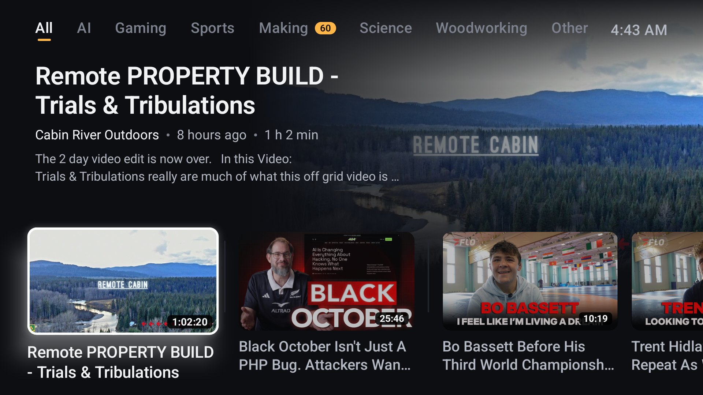
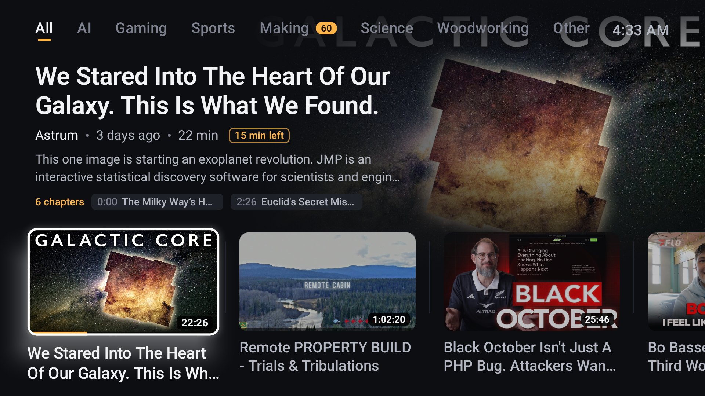
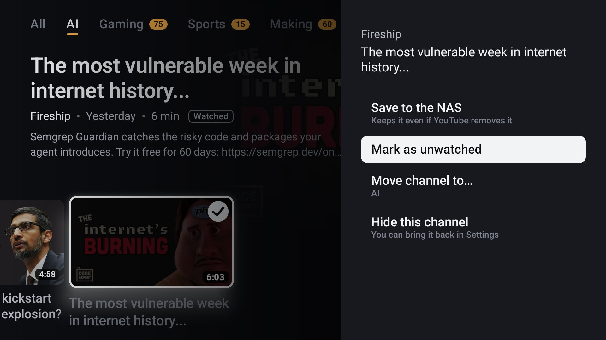
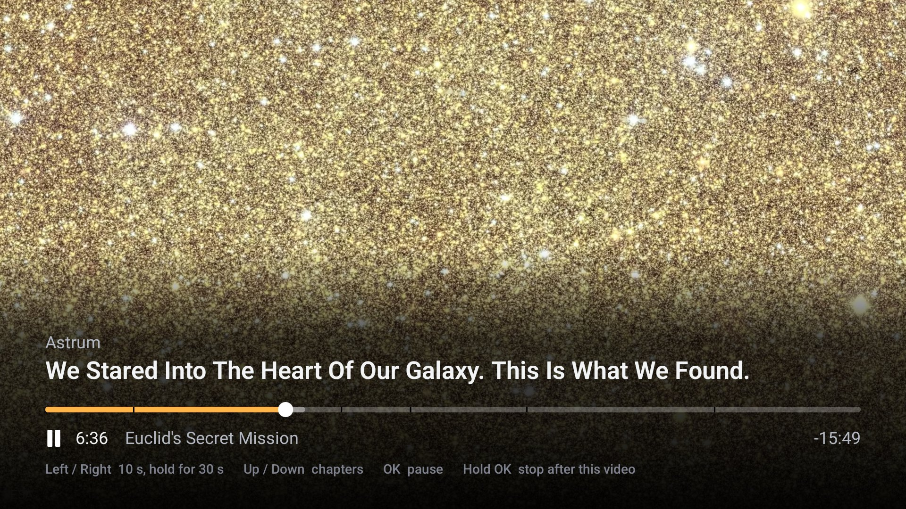
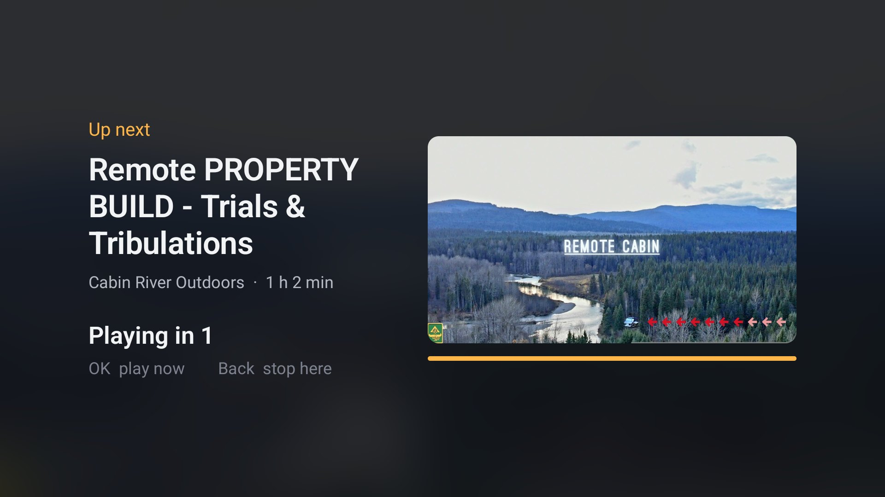

# Subfeed

A self-hosted, subscriptions-only YouTube viewer for Android TV and Google TV. It shows the latest uploads from the channels you subscribe to, sorted into tabs, and nothing else.



## Why

YouTube's TV home screen is built to keep you watching, not to show you what the people you chose to follow just posted. Your subscriptions are a tab you have to hunt for, buried under recommendations, Shorts and live streams.

Subfeed flips that. The only things on screen are uploads from your own subscriptions, grouped into tabs you control (AI, Woodworking, Sports, whatever your channels are about). There are no Shorts, no live streams, no ads on playback, no recommendations and no algorithm. Nothing is drawn over a video while it plays.

## Screenshots

| | |
|---|---|
|  |  |
| Featured video, chapter list, and "15 min left" on a half-watched video | Long-press menu on a video |
|  |  |
| Player with chapter marks and remote hints | Up next, with a 5 second countdown |

The thumbnails are public YouTube videos from the author's own subscriptions.

## Features

- Only your subscriptions, synced from your Google account (read-only access). Channels are polled with yt-dlp, so no YouTube API quota is spent on videos.
- No Shorts, no live streams or premieres still in progress, no members-only or age-restricted videos. Duplicates are removed.
- Tabs by category. An LLM (any model on OpenRouter; optional) sorts new channels, or you move them yourself. You can have up to 7 tabs plus Other.
- A featured video with its description and chapters, a row of recent uploads, and a 5-across grid per tab.
- Its own Media3 player: separate video and audio streams up to 2160p, hardware decoding, captions.
- SponsorBlock: sponsor segments are skipped automatically, with a 3 second note and a one-key undo.
- Chapters: a chapter list on the home screen, chapter marks on the progress bar, and next/previous chapter keys.
- Up next: when a video ends, a card counts down 5 seconds and plays the next unwatched video in the row. Back cancels.
- Continue Watching tab: every video you started and haven't finished, most recently played first, with time left. A video counts as watched at 95%, or when under 75 seconds of non-sponsor content remain. A video you haven't touched in 14 days drops back into its tab (your place in it is kept).
- History tab: everything you've played, most recent first. Watched videos stay in their tabs, dimmed with a check mark, and can be marked unwatched.
- Go to channel: a grid of one channel's stored videos, reachable from any video's long-press menu or from Settings > Channels.
- Long-press menu: Go to channel, Save, Play from start, Mark watched or unwatched, Move channel to another tab, Hide from Subfeed.
- Save to NAS: download a video as an MP4 (with thumbnail, captions and metadata) to a directory you choose, so it survives YouTube removing it.
- Settings > Channels: every channel with its unwatched count, last upload and last watched, filterable by tab (including Hidden) and sortable A to Z or by least recently watched. Hidden channels can be brought back from there.
- Plain-sentence status lines in Settings: last sync, whether playback currently works, yt-dlp version, saved-videos space.
- Bearer-token authentication on the API and a pinned certificate in the app. No cleartext traffic.

## How it works

```
 Android TV app (Kotlin, Compose for TV, Media3)
        |
        |  HTTPS, bearer token. The app trusts only your server's own
        |  certificate authority for this host (Caddy "tls internal").
        v
 Caddy :443  -->  Subfeed service 127.0.0.1:8000 (FastAPI, SQLite)
                     |-- yt-dlp ........ finds new uploads, resolves playable stream URLs
                     |-- SponsorBlock .. sponsor segments, by video id
                     |-- categorizer ... optional, OpenRouter chat completions
                     |-- save worker ... MP4s to a mounted directory (optional)
                     `-- YouTube Data API ... your subscription list only (read-only OAuth)
```

The service does the slow and fragile work: syncing your subscription list once a day, polling channels on a schedule, extracting stream URLs, tracking watch progress. The TV app is a thin client. When you press play, the service resolves a stream and the TV fetches it from YouTube directly (in bounded 10 MB range requests, because YouTube throttles open-ended ones), merges video and audio, and reports progress back. Saved videos are served from your own storage.

## Requirements

- An always-on Linux machine or container on your home network. Debian or Ubuntu with Python 3.12 or newer, ffmpeg, Caddy and deno. About 1 GB of RAM.
- An Android TV or Google TV device with developer options and network debugging turned on, and `adb` on your computer. It has been used on a Sony Bravia with Google TV; other devices are untested.
- A Google Cloud project with the YouTube Data API v3 enabled and an OAuth client (free, takes about 10 minutes; see [docs/google-setup.md](docs/google-setup.md)).
- To build the app: JDK 17 and the Android SDK (platform 34, build-tools 34.0.0).
- Optional: an [OpenRouter](https://openrouter.ai) API key for automatic categories.
- Optional: a NAS share, second disk or any mount for saved videos.

## Setup

The long version of the server steps is in [docs/self-hosting.md](docs/self-hosting.md). The short version:

### 1. Run the service

On the server, as root:

```bash
apt-get install -y python3 python3-venv python3-pip ffmpeg git curl unzip sqlite3 caddy
# install deno to /usr/local/bin (see docs/self-hosting.md)
useradd --system -g subfeed -m -d /opt/subfeed -s /bin/bash subfeed   # after groupadd --system subfeed
cp -a service /opt/subfeed/service && chown -R subfeed:subfeed /opt/subfeed
su subfeed -c 'python3 -m venv /opt/subfeed/venv && /opt/subfeed/venv/bin/pip install -e /opt/subfeed/service'
```

### 2. Environment file

`/etc/subfeed/subfeed.env`, owned `root:subfeed`, mode 0640:

```bash
SUBFEED_API_TOKEN=...        # required; openssl rand -hex 32. Compiled into the APK.
GOOGLE_CLIENT_ID=...         # from docs/google-setup.md
GOOGLE_CLIENT_SECRET=...
OPENROUTER_API_KEY=...       # optional; without it new channels land in "Other"
```

Other service variables (all optional): `SUBFEED_DB` (database path, default `/var/lib/subfeed/subfeed.db`), `SUBFEED_SAVED_DIR` (saved videos, default `/srv/saved`, must be a mount point), `SUBFEED_GOOGLE_TOKEN` (where the Google token is kept), `SUBFEED_SCHEDULER`, `SUBFEED_SAVE_WORKER`, `SUBFEED_CANARY` (set any of these to `0` to turn that part off). The table in [docs/self-hosting.md](docs/self-hosting.md#3-the-env-file) explains each one.

### 3. systemd and Caddy

```bash
cp infra/systemd/subfeed.service infra/systemd/subfeed-backup.service infra/systemd/subfeed-backup.timer /etc/systemd/system/
sed 's/YOUR_SERVER_IP/192.0.2.10/g' infra/caddy/Caddyfile > /etc/caddy/Caddyfile   # your server's real LAN IP
systemctl daemon-reload && systemctl enable --now subfeed subfeed-backup.timer && systemctl reload caddy
```

Give the server a fixed IP first. Caddy creates its own certificate authority on first use. The root certificate is at `/var/lib/caddy/.local/share/caddy/pki/authorities/local/root.crt`. Copy that file to the computer where you will build the app.

### 4. Google Cloud project

Create the project, enable the YouTube Data API, make an OAuth client of type "TVs and Limited Input devices", and publish the consent screen. Step by step: [docs/google-setup.md](docs/google-setup.md). Put the client id and secret in the env file and run `systemctl restart subfeed`.

### 5. Build the APK

Three environment variables describe your server; a fourth pair signs the release.

| Variable | Value |
|---|---|
| `SUBFEED_API_BASE` | `https://YOUR_SERVER_IP` (no trailing slash; must match a name or address in Caddy's certificate) |
| `SUBFEED_API_TOKEN` | the same token as in the server's env file |
| `SUBFEED_CA_PEM` | path to the `root.crt` you copied from the server |
| `SUBFEED_KEYSTORE`, `SUBFEED_KEYSTORE_PASS` | a signing keystore and its password (alias `subfeed`, key password equal to the store password) |

Make a keystore once and keep it; you need the same one to update the app later:

```bash
keytool -genkeypair -keystore subfeed-release.jks -alias subfeed -keyalg RSA -keysize 2048 \
  -validity 10000 -storepass CHOOSE_A_PASSWORD -keypass CHOOSE_A_PASSWORD -dname "CN=Subfeed"
```

Then, with a local Android SDK (`ANDROID_HOME` set) and JDK 17:

```bash
cd tv
SUBFEED_API_BASE=https://YOUR_SERVER_IP \
SUBFEED_API_TOKEN=YOUR_TOKEN \
SUBFEED_CA_PEM=/path/to/root.crt \
SUBFEED_KEYSTORE=/path/to/subfeed-release.jks \
SUBFEED_KEYSTORE_PASS=CHOOSE_A_PASSWORD \
SUBFEED_VERSION_CODE=$(( $(date +%s) / 60 )) \
./gradlew assembleRelease
```

The APK is `tv/app/build/outputs/apk/release/app-release.apk`. The build fails with a clear message if the base URL, token, CA or keystore is missing. `SUBFEED_VERSION_CODE` just has to grow with each build so a new APK installs over the old one.

The token and the pinned CA are inside the APK, so treat the file like a password: do not post it anywhere.

### 6. Install on the TV

On the TV: Settings > System > About, tap the build number seven times, then in Developer options turn on USB debugging or network debugging. Note the TV's IP address. From your computer:

```bash
adb connect TV_IP:5555
adb -s TV_IP:5555 install -r tv/app/build/outputs/apk/release/app-release.apk
```

The TV asks you to accept the computer's key the first time. Subfeed then appears in the TV's app list.

### 7. Sign in on the TV

Open Subfeed > Settings > **Sign in with Google**. The TV shows a code; enter it at `google.com/device` on your phone. Google will say it has not verified the app (see Limitations); choose Advanced, then continue. Your subscriptions sync right away and the first channel polls start in the background. The first minutes show an empty or partial home screen while videos are discovered.

Before signing in, you can seed a starting list with `subfeed seed` (see [docs/self-hosting.md](docs/self-hosting.md#4-seed-channels-optional)).

## Using it

| Key | Where | What it does |
|---|---|---|
| Left / Right | Home row | One video at a time. Hold to jump channel by channel; keep holding to scroll fast. |
| Up / Down | Home | Up goes to the tabs, Down returns to the row (to the video you were on). |
| OK | On a tab | Opens that tab as a 5-across grid. Back closes it. |
| OK | On a video | Plays it. |
| Hold OK | On a video | Long-press menu (Go to channel, Save, Play from start, Mark watched, Move channel, Hide). |
| Fast-forward | Home or grid | Jumps to the next unwatched video. |
| Menu / Settings key, or the Settings tab | Home | Opens Settings. |
| Left / Right | Player | Seek 10 seconds. Hold for 30. Fast-forward and rewind keys also seek 30. |
| Up / Down | Player | Controls and chapters. A second Up opens the action row (Next chapter, Captions, and so on). |
| Channel up / down | Player | Next or previous chapter. |
| OK, Play/Pause | Player | Pause or resume. |
| Down (within 3 s of a skip) | Player | Undo a SponsorBlock skip. |
| Hold OK | Player | Stop after this video (no Up next). |
| Back | Anywhere | Hides the controls, then leaves the player, then goes up to the tabs, then leaves the app. |

Settings > Channels lists every channel with its unwatched count, last upload and last watched. Use the filter chips (All, a tab, Other, Hidden) and the sort button to find one; hidden channels can be shown again from there.

[docs/couch-test.md](docs/couch-test.md) is a 10 minute checklist you can run with the remote after installing.

## Updating

- **Service:** copy the new `service/` over `/opt/subfeed/service`, `pip install -e` it again, and `systemctl restart subfeed`. Details are in [docs/self-hosting.md](docs/self-hosting.md#updating-the-service).
- **yt-dlp:** pinned in `service/pyproject.toml`. When playback breaks, `pip install -U yt-dlp` in the venv and restart. It is never upgraded automatically.
- **TV app:** rebuild with the same keystore, a larger `SUBFEED_VERSION_CODE`, and `adb install -r`. Watch progress and history live on the server, so nothing is lost.
- If you rebuild the server, Caddy makes a new certificate authority. Rebuild the APK with the new `root.crt`, or restore `/var/lib/caddy` from backup.

## Limitations and caveats

- **Personal tool.** It is built for one household: one Google account, one token, a handful of TVs on one network. Nothing about it is multi-user.
- **It depends on yt-dlp and will break.** YouTube changes how it serves video often. Expect playback to fail now and then until yt-dlp ships a fix. Settings says so in plain words when the hourly check fails. After repeated bot-checks the service pauses its background YouTube requests for 6 to 24 hours.
- **Google shows an "unverified app" screen.** The OAuth client is yours, in your own project, and has not been through Google's review. That is normal for personal use. The app asks for read-only YouTube access (`youtube.readonly`) and cannot change your account. Publish the consent screen ("In production") so the sign-in does not expire every 7 days.
- **LAN only by default.** The server is reachable on your home network. Playing away from home is not built and not tested. If you expose it to the internet yourself, you take on the security of a single static token.
- **`/api/health` needs no token.** It returns sync times, the yt-dlp version and error flags, and nothing else. Everything else does.
- **YouTube terms.** Extracting streams with yt-dlp and saving videos may go against YouTube's terms of service in your country. Subfeed is a tool; how you use it is your decision and your risk. Not affiliated with or endorsed by Google or YouTube.
- **Android TV only.** There is no phone, tablet or web client.
- **Categorizing sends channel names and descriptions to OpenRouter** if you set an API key. Leave it unset to keep everything local.

## Project layout

```
service/          FastAPI service (subfeed package, tests, seed/)
tv/               Android TV app (Kotlin, Compose for TV), Gradle project
  screenshots/    images used in this README
infra/            Caddyfile and systemd units (templates)
docs/             self-hosting.md, google-setup.md, couch-test.md
```

## Development

Service tests (no network needed; yt-dlp responses are recorded fixtures):

```bash
cd service
python3 -m venv .venv
.venv/bin/pip install -e '.[test]'
.venv/bin/pytest -q
```

TV unit tests and a release build, with a local Android SDK:

```bash
cd tv
SUBFEED_API_BASE=https://subfeed.example SUBFEED_API_TOKEN=test SUBFEED_CA_PEM=/path/to/any.pem \
SUBFEED_KEYSTORE=/path/to/keystore.jks SUBFEED_KEYSTORE_PASS=... \
./gradlew testReleaseUnitTest assembleRelease
```

For unit tests alone (`./gradlew testReleaseUnitTest`) none of the variables are required; a placeholder certificate and server name are generated.

The home screen's focus movement is a pure model (`FocusModel.kt`) with unit tests, not Compose's focus system; start there if you want to change how navigation feels.

## License

MIT. See [LICENSE](LICENSE).
